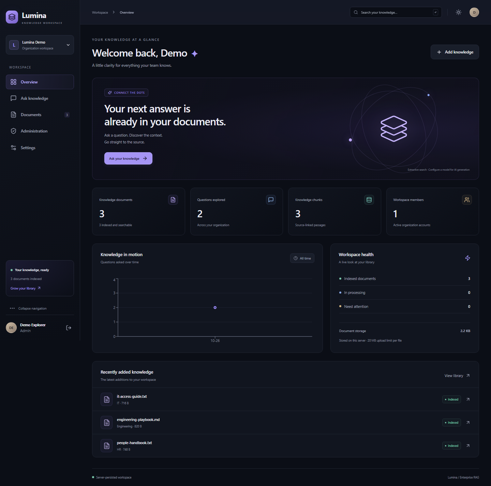
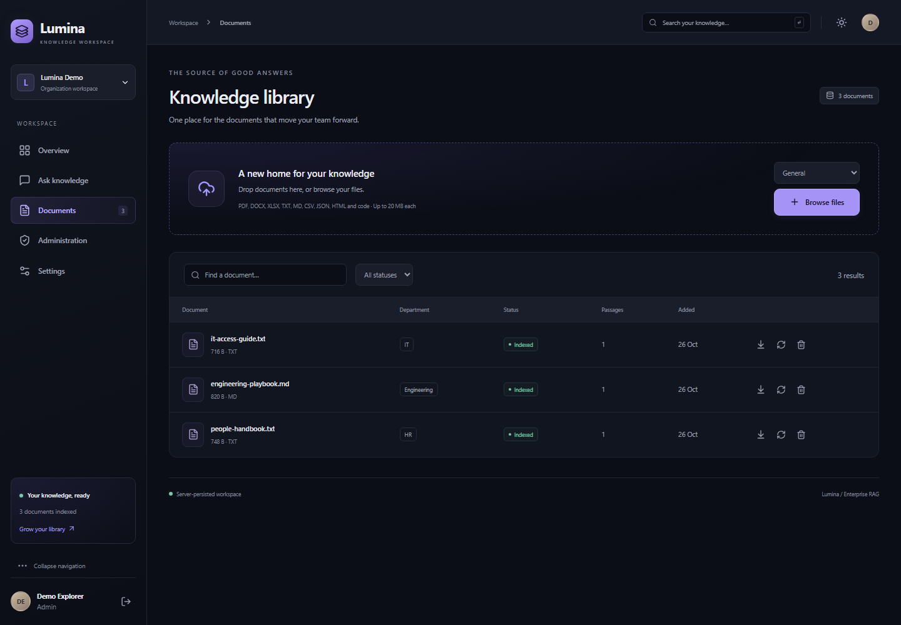
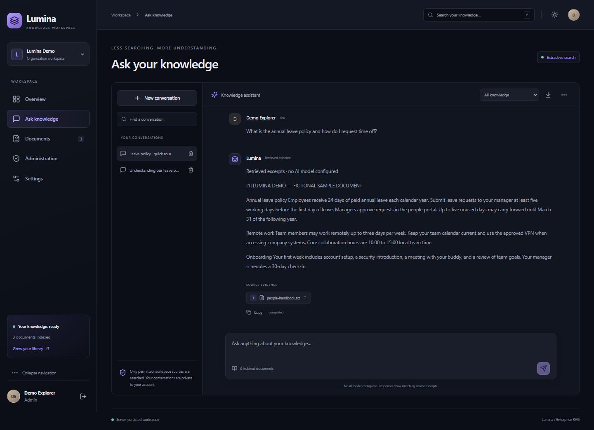
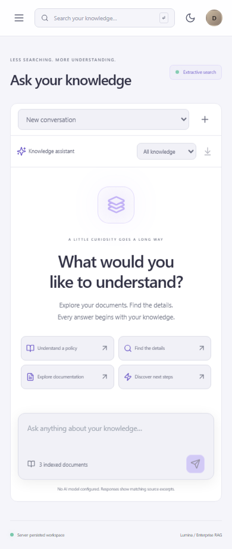
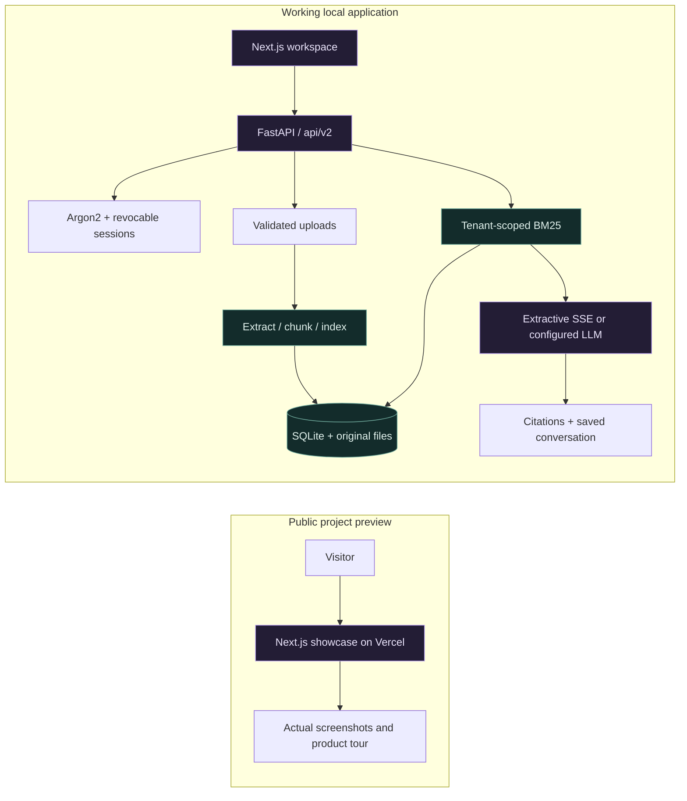

<p align="center">
  
</p>

<p align="center">
  <a href="https://github.com/manikantbindass/Enterprise-RAG-Knowledge-Assistant/actions/workflows/ci.yml"></a>
  
  
  
  
</p>

<p align="center">
  <strong>A thoughtful home for documents, questions, and the evidence behind every answer.</strong><br />
  Enterprise RAG Knowledge Assistant · Designed as Lumina
</p>

<p align="center">
  <a href="#project-preview">Project preview</a> ·
  <a href="https://enterprise-rag-knowledge-assistant-three.vercel.app">Live showcase ↗</a> ·
  <a href="#demo-credentials">Demo credentials</a> ·
  <a href="#inside-the-workspace">Screenshots</a> ·
  <a href="#quick-start">Quick start</a> ·
  <a href="#architecture">Architecture</a> ·
  <a href="#engineering-notes">Engineering notes</a>
</p>


## Project preview

**Lumina turns scattered documents into a connected knowledge workspace.** Upload a policy, handbook, spreadsheet or technical guide; search its passages; ask questions; and follow citations back to the evidence.

The interface pairs charcoal and navy surfaces with restrained lavender accents, translucent panels, calm typography, and responsive navigation. Dark, light and system themes adapt to your workspace.

> **Two ways to explore:** the public Vercel frontend presents a visual product tour with real application screenshots. The complete local app provides authenticated accounts, document ingestion, retrieval, chat and persisted records. A hosted backend is not connected to the public showcase.

### [Open the live showcase ↗](https://enterprise-rag-knowledge-assistant-three.vercel.app)

**Public URL:** https://enterprise-rag-knowledge-assistant-three.vercel.app — browse all four screen previews without signing in. The production frontend is hosted on Vercel; the backend remains local.

| Experience | What you can do |
| :--- | :--- |
| **Public frontend showcase** | Browse the product tour, switch between actual screen captures, inspect the workflow, and find local setup instructions. No account required. |
| **Working local application** | Sign in, upload documents, search knowledge, open source citations, save conversations, and manage your organization. |
| **Optional AI generation** | Configure OpenAI or Ollama on the API server. Without a model, responses explicitly show matching source excerpts. |


## Demo credentials

A dedicated, **opt-in local demo workspace** is available. Start the API and frontend first, then run:

```powershell
.\.venv\Scripts\python.exe scripts/seed-demo.py
```

| Field | Value |
| :--- | :--- |
| **Local sign-in URL** | [http://localhost:3100](http://localhost:3100) |
| **Email** | `demo@lumina.local` |
| **Password** | `LuminaDemo!2026` |
| **Workspace** | `Lumina Demo` |
| **Role** | Organization administrator in the demo organization |

The seed creates three fictional documents across **HR, Engineering and IT**, waits for real indexing, and saves a source-backed example conversation when extractive mode is active. Running it again preserves the account and avoids duplicate sample files. It never resets an existing account and only targets a loopback API.

**These credentials are public and intended for fictional local demo data only. They do not provide a hosted login on the Vercel showcase.** Normal workspaces still require real account registration; no shared account is created automatically.

<details>
<summary><strong>Using a different local port?</strong></summary>

If your frontend uses port 3000, send its allowed Origin explicitly:

```powershell
.\.venv\Scripts\python.exe scripts/seed-demo.py --origin http://localhost:3000
```

For a different local API port:

```powershell
.\.venv\Scripts\python.exe scripts/seed-demo.py --api http://127.0.0.1:8001 --origin http://localhost:3100
```

</details>


## Inside the workspace

**Actual screenshots from the running application**, captured with the demo account above. All document content shown is explicitly fictional sample knowledge.

### 01 · Overview — knowledge at a glance

The dashboard brings together document totals, indexed passages, query activity and processing health. The collapsible sidebar keeps the library, conversations, administration and settings close at hand.

<p align="center"><a href="docs/assets/screenshots/dashboard.png"></a></p>

### 02 · Library & conversations — from documents to evidence

<table>
  <tr>
    <td width="50%"><a href="docs/assets/screenshots/documents.png"></a></td>
    <td width="50%"><a href="docs/assets/screenshots/chat.png"></a></td>
  </tr>
  <tr>
    <td><strong>Document library</strong><br />Drag in files, organize by department, monitor real processing states, preview extracted passages, and reindex or download originals.</td>
    <td><strong>Ask your knowledge</strong><br />Explore source-backed answers, inspect exact excerpts, switch document context, and return to persisted conversations.</td>
  </tr>
</table>

### 03 · Mobile — a workspace that travels

Responsive navigation, a mobile conversation picker and a comfortable composer keep the essentials usable on smaller screens. The light appearance shown here is part of the same design system.

<details>
<summary><strong>Open the mobile preview</strong></summary>
<p align="center"><a href="docs/assets/screenshots/mobile.png"></a></p>
</details>


## What works today

| Area | Implemented in the local runtime |
| :--- | :--- |
| **Identity & access** | Argon2 password hashing, expiring HttpOnly sessions, logout revocation, Origin validation, admin/member/viewer roles and account deactivation. |
| **Organization isolation** | Documents and retrieval scoped to authenticated organization membership; conversations scoped to their author and organization. |
| **Document intelligence** | Validated PDF, DOCX, XLSX and UTF-8 text uploads; real extraction, bounded overlapping chunks, restartable ingestion states, previews, download, delete and reindex. |
| **Retrieval & citations** | Server-side lexical BM25, source excerpts, real PDF page references and clickable citation previews. |
| **Conversation workspace** | Backend SSE, persisted responses, error/cancellation paths, conversation search, rename/delete/export and Markdown rendering. |
| **Optional model adapters** | Server-configured OpenAI and Ollama streaming adapters. Live generation requires your configured provider. |
| **Analytics & administration** | Persisted document/query/storage/member metrics, activity chart, audit records and member controls. |
| **Interface** | Responsive layouts, dark/light/system appearance, keyboard focus states, accessible dialogs and reduced-motion support. |

**Status:** a verified local foundation with an evolving enterprise roadmap. Dense semantic/hybrid retrieval, enterprise SSO and the other planned capabilities below are not advertised as complete.


## Quick start

### Windows · full local workspace

Prerequisites: **Python 3.12**, **Node.js 22 or 24**, and Git.

```powershell
git clone https://github.com/manikantbindass/Enterprise-RAG-Knowledge-Assistant.git
cd Enterprise-RAG-Knowledge-Assistant

py -3.12 -m venv .venv
.\.venv\Scripts\python.exe -m pip install -r backend/runtime/requirements-dev.txt

cd frontend
npm ci
npm run build
cd ..

powershell -ExecutionPolicy Bypass -File scripts/start-local.ps1 -FrontendPort 3100
.\.venv\Scripts\python.exe scripts/seed-demo.py
```

| Service | URL |
| :--- | :--- |
| **Application** | [localhost:3100](http://localhost:3100) |
| **API documentation** | [localhost:8000/docs](http://localhost:8000/docs) |
| **API health** | [localhost:8000/health](http://localhost:8000/health) |

Sign in using the demo credentials, or create your own independent workspace at `/register`. Pass `-Development` to the launcher for hot reload. Logs and process IDs are written under `data/logs`; database records and originals persist under ignored `data/`.

<details>
<summary><strong>Linux / macOS</strong></summary>

```bash
python3.12 -m venv .venv
source .venv/bin/activate
pip install -r backend/runtime/requirements-dev.txt
cd frontend && npm ci && npm run build
```

Run these in separate terminals from the repository root:

```bash
# API
source .venv/bin/activate
export RAG_ALLOWED_ORIGINS=http://localhost:3100,http://127.0.0.1:3100
uvicorn backend.runtime.main:app --host 127.0.0.1 --port 8000
```

```bash
# Frontend
cd frontend
npm run start -- --hostname 127.0.0.1 --port 3100
```

Then seed the demo from the repository root:

```bash
.venv/bin/python scripts/seed-demo.py
```

</details>

<details>
<summary><strong>Docker Compose</strong></summary>

```bash
docker compose up --build
```

The default Compose stack binds the frontend to **localhost:3000** and API to **localhost:8000**, with a persistent local volume. To seed it from a host Python environment:

```bash
python scripts/seed-demo.py --origin http://localhost:3000
```

Docker image execution requires a running engine; it was not verified on the original development machine. The previous microservice configuration is retained as `docker-compose.legacy.yml` for reference.

</details>

### Enable AI generation

The default mode is **extractive**: it retrieves and quotes relevant evidence. To generate answers with an LLM, configure the **API server environment** and restart it:

```powershell
# Ollama: install and run a compatible model first.
$env:RAG_PROVIDER='ollama'
$env:RAG_MODEL='<your-installed-model>'
$env:OLLAMA_BASE_URL='http://127.0.0.1:11434'
```

For OpenAI, use `RAG_PROVIDER=openai`, set `RAG_MODEL` to an available Chat Completions-compatible model, and provide `OPENAI_API_KEY` only to the server. Credentials never belong in the browser or README. No model download or paid API call is made automatically by the demo seed.


## Architecture



### Repository map

```text
frontend/
  src/components/workspace/   Authenticated local app UI
  src/components/showcase/    Public frontend product tour
  src/lib/runtime.ts         API and streaming client
  public/showcase/           Actual demo screenshots for the public site
backend/runtime/             Supported modular FastAPI runtime
scripts/seed-demo.py         Explicit, idempotent local demo setup
scripts/start-local.ps1      Local process launcher
frontend/scripts/           Repeatable screenshot capture
backend/*_service/           Preserved microservice reference implementations
docs/assets/                 Animated SVGs and real project screenshots
docs/engineering/            Audit, progress, operations and roadmap
```

The public showcase is enabled with `NEXT_PUBLIC_SHOWCASE_MODE=true`. It does not connect to a local API from Vercel. The authenticated workspace remains the default for normal local startup.


## Verification

The local foundation passed **13 backend tests, 3 streaming-parser tests and 2 browser workflows**, along with production build, TypeScript, lint and dependency checks. Tests cover account/session validation, organization isolation, real file parsers, persisted citations, provider stream formats and responsive workflows. See the CI badge for the latest remote result.

```powershell
.\.venv\Scripts\python.exe -m pytest backend/runtime/tests -q --confcutdir=backend/runtime/tests
.\.venv\Scripts\python.exe -m ruff check backend/runtime
cd frontend
npm run lint
npm run typecheck
npm test
npm run build
# With the local frontend and API running:
npx playwright install chromium
$env:PLAYWRIGHT_BASE_URL='http://127.0.0.1:3100'
npm run test:e2e
```

<details>
<summary><strong>Recreate the README screenshots</strong></summary>

Seed the local demo account, keep both services running on the documented ports, then:

```powershell
cd frontend
node scripts/capture-readme.mjs
```

This signs into the real app, captures overview/library/chat/mobile screens into `docs/assets/screenshots`, and returns the demo workspace to dark mode. Public showcase assets are copies under `frontend/public/showcase`.

</details>

## Engineering notes

| Document | What it explains |
| :--- | :--- |
| [Initial audit](docs/engineering/INITIAL_AUDIT.md) | Baseline architecture, fake-login/browser-storage issues, dependency and integration gaps. |
| [Implementation progress](docs/engineering/PROGRESS.md) | Executed checks, verified results, original legacy test failures and remaining work. |
| [Operations](docs/engineering/OPERATIONS.md) | Configuration, storage, backup, authorization boundaries and deployment limitations. |
| [Implementation roadmap](docs/engineering/IMPLEMENTATION_ROADMAP.md) | The path from the local foundation to enterprise capabilities. |

**Still on the roadmap:** PostgreSQL/Alembic/RLS, pgvector and hybrid retrieval, S3 signed downloads, independent workers, distributed limits, document ACLs/versions, OCR and malware scanning, OIDC/SSO/MFA/recovery/SCIM, Azure/Anthropic, bounded agents, external connectors, budgets/billing, retention and production observability.

Legacy service source is preserved. Existing browser data is not automatically imported or deleted. This repository does not claim SOC 2 certification or a completed production enterprise deployment.

<p align="center"><a href="#"></a></p>
<p align="center"><a href="#">Back to top ↑</a> · <a href="https://github.com/manikantbindass/Enterprise-RAG-Knowledge-Assistant">Explore the source</a></p>
